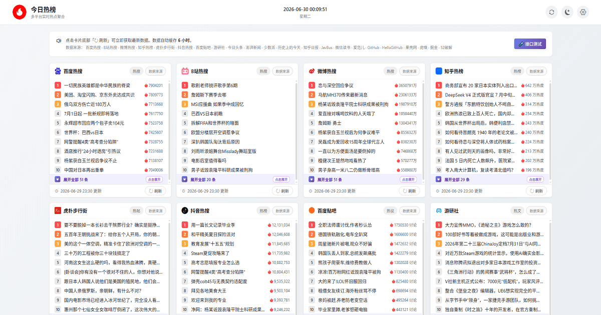

# 今日热榜 - 多平台实时热点聚合

一个轻量级的 PHP 热搜聚合站，**50+ 平台**热榜数据一个页面看完。** 纯原生 PHP + 原生 JS**。

 



---

## ✨ 特性

- 🎯 **50+ 平台**：百度、微博、知乎、Bilibili、抖音、虎扑、贴吧、今日头条、澎湃新闻、Acfun、少数派、GitHub、第一财经、微信读书…
- ⚡ **三层缓存**：页面级静态缓存 + 平台 JSON 缓存 + OPcache，二次访问几毫秒
- 🌓 **夜间模式**：一键切换，localStorage 记忆
- 📱 **响应式**：手机、平板、桌面自适应
- 🔌 **对外 API**：统一 JSON 格式，可选开启/关闭
- 🎨 **iconfont 图标字体**：68 个内置图标，随时扩展
- 📊 **API 调用统计**：stats.php 看 7 日 Top 平台
- 🗺️ **动态 Sitemap**：实时反映启用的平台，爬虫友好
- 🔒 **安全加固**：敏感目录 Nginx deny + robots.txt + 安全响应头

---

## 📦 目录结构

```
***/
├── index.php            ← 首页入口（渲染卡片网格）
├── config.php           ← 【唯一配置文件】所有配置都在这里
├── platform.php         ← 单平台详情页
├── stats.php            ← API 调用统计
├── status.php           ← 服务状态监控
├── sitemap.php          ← 动态网站地图（PHP 输出 XML）
├── robots.txt           ← 爬虫规则
├── nginx.conf           ← 宝塔 / 云服务器专用
├── nginx.htaccess       ← phpStudy 本地专用（include 引入）
│
├── home/                ← 页面组件
│   ├── header.php       ← 页头（CSS/导航/DNS 预解析）
│   ├── notice-bar.php   ← 顶部通知栏
│   └── footer.php       ← 页脚（状态/sitemap/JS 注入）
│
├── core/                ← 核心逻辑
│   ├── fetcher.php      ← 数据抓取 + 文件缓存读写
│   ├── curl_helper.php  ← CURL 封装（smartCurlInit + smartCurlExec 错误日志）
│   ├── helper.php       ← 工具函数（时间格式化/HTML 转义）
│   ├── refresh.php      ← AJAX 刷新接口
│   └── clear_cache.php  ← OPcache + 页面缓存清理
│
├── api/                 ← API 系统
│   ├── index.php         ← API 路由入口（ENABLE_API_ROUTER 开关）
│   ├── V1/               ← 53 个平台处理器
│   ├── V2/               ← 24 个平台处理器（可配 api_version 切换）
│   └── utils/config.php  ← API 白名单（两个 config 必须同步）
│
├── assets/
│   ├── css/style.css     ← 主样式（日间模式）
│   ├── css/theme-dark.css ← 夜间模式
│   ├── css/icon-color.css ← 平台图标颜色（集中管理）
│   ├── css/responsive.css ← 响应式
│   ├── js/script.js      ← 卡片交互（展开/折叠/刷新）
│   ├── iconfont/         ← 图标字体（68 个内置）
│   ├── images/           ← favicon/OG 图
│   └── ad/               ← 广告图片（本土化后放这里）
│
└── cache/                ← 自动生成的缓存文件（.htaccess 保护）
└── logs/                 ← smartCurlExec 错误日志（curl 失败才写）
```

---

## 🚀 快速开始

### 环境要求

- PHP **7.4+**（推荐 8.0+）
- PHP 扩展：`curl`、`json`
- Web 服务器：**Nginx**（推荐）或 Apache

### 三步上线

**1. 放到 Web 根目录**

phpStudy / 宝塔 / 任何 LNMP 环境，把整个项目丢进去。

**2. Nginx 配置**

- 宝塔 / 云服务器：打开 [nginx.conf](nginx.conf)，复制里面的 server{} 内容粘贴到面板生成的站点配置里
- 本地 phpStudy：打开 [nginx.htaccess](nginx.htaccess)，按注释说明在 vhost 里一行 include 引入即可

> gzip 必须在全局 http{} 块开启。宝塔面板里打勾就行；phpStudy 打开 `Extensions/Nginx版本号/conf/nginx.conf` 把注释的 `#gzip on;` 换成完整配置（见 nginx.htaccess 顶部注释）。

**3. 改 config.php**（必改 3 处）

| 位置 | 改什么 |
|---|---|
| `site_name` | 你的站名称 |
| `seo_domain` | 你的域名（如 `https://你的域名.com`） |
| `opcache_clear_key` | 改成你自己的密钥 |

**4. 改 robots.txt**（1 处）

文件最后一行 `Sitemap:` 后面的域名，改成你的实际域名：
```
Sitemap: https://你的域名/sitemap.php
```
> 如果 Nginx 加了 sitemap.xml rewrite，可以改成 `/sitemap.xml`。

搞定！访问域名即可看到首页。

### 可选：加平台

在 `api/V1/` 创建处理器 → `api/utils/config.php` 白名单注册 → `config.php` 的 `$sources` 加一条 → `icon-color.css` 加颜色类。详见"添加新平台"章节。

---

## ⚙️ 配置速查（config.php）

### 显示配置

| 项 | 作用 | 默认值 |
|---|---|---|
| `columns_per_row` | 每行几个卡片 | `auto`（自适应） |
| `card_min_width` | 卡片最小宽度 | `280` px |
| `card_height` | 卡片高度 | `400` px |
| `display_limit` | 默认显示条数 | `10` 条（超出可展开） |
| `default_theme` | 默认主题 | `light`（可选 `dark`/`auto`） |

### 功能开关（true/false）

| 项 | 作用 |
|---|---|
| `show_notice_bar` | 顶部通知栏 |
| `show_refresh_btn` | 卡片刷新按钮 |
| `show_heat` | 热度值小火苗 |
| `show_source_link` | 数据来源链接 |
| `page_cache_enable` | 页面级静态缓存（**必开**） |

### 缓存时间

| 项 | 作用 | 默认值 |
|---|---|---|
| `cache_ttl` | 平台 JSON 缓存 | `43200`（12 小时） |
| `page_cache_ttl` | 页面 HTML 缓存 | `1800`（30 分钟） |

### 广告配置

```php
'top_banner_ads' => [
    ['enabled' => true, 'title' => '...', 'img' => '/assets/ad/xxx.jpg', 'url' => 'https://...'],
    // 多条 banner 循环输出
],
'grid_slot_ad' => [
    'enabled'           => true,
    'grid_insert_after' => 0,  // 0 = 最前面，6 = 第 6 张后，false = 关
    'title' => '...', 'img' => '...', 'url' => '...',
],
```

---

## 🔌 API 用法

### 对外 HTTP API（可选开启）

开关在 `api/index.php` 顶部：
```php
define('ENABLE_API_ROUTER', true);
```

请求示例：
```
GET /api/index.php/baidu?limit=10
GET /api/index.php/weibo?limit=20
GET /api/index.php/zhihu?limit=5&force=1    ← force=1 跳过缓存强制刷新
```

统一返回格式：
```json
{
    "success": true,
    "title": "百度热搜",
    "subtitle": "热搜",
    "total": 50,
    "update_time": "2026-11-19 19:49:50",
    "data": [
        {"index": 1, "title": "热搜标题", "hot": "4,992,109", "url": "...", "desc": "", "pic": ""}
    ]
}
```

### API 版本切换

config.php 里 `api_version = 'V1'` 或 `'V2'`，对应 `api/V1/` 和 `api/V2/` 目录的处理器。

---

## 🗺️ Sitemap & SEO

- **动态生成**：`sitemap.php` 每次访问实时扫平台列表 + 读缓存时间 → 爬虫每次都拿到最新 sitemap
- **robot.txt 已配置**：`Sitemap: https://你的域名/sitemap.php`（部署时记得改域名），爬虫自动发现
- **Nginx rewrite 可选**：加一行 `location = /sitemap.xml { try_files $uri /sitemap.php; }` 让爬虫走标准路径
- **Canonical URL**：`config.php` 的 `seo_domain` 用于生成 Canonical 标签和 OG 链接
- **百度站长平台**：上线后去 [ziyuan.baidu.com](https://ziyuan.baidu.com) 提交 sitemap，收录速度翻倍

---

## 🛠️ 添加新平台（5 步 Checklist）

假设要加 "掘金"（id: `juejin`）：

| 步骤 | 做什么 | 文件 |
|---|---|---|
| 1 | 创建处理器类 `JuejinHotSearch` | `api/V1/juejin.php` |
| 2 | V2 版本（可选，配了 api_version=V2 必须加） | `api/V2/juejin.php` |
| 3 | API 白名单注册 id | `api/utils/config.php` → `platforms[]` |
| 4 | 首页配置注册显示信息 | `config.php` → `$sources[]` |
| 5 | 图标颜色 | `assets/css/icon-color.css` → `.juejin-icon { color: #xxx; }` |

类名规则：`{id}` 下划线分段 → 每段首字母大写 + `HotSearch`。例如：
- `baidu` → `BaiduHotSearch`
- `zhihu_daily` → `ZhihuDailyHotSearch`
- `360search` → `_360searchHotSearch`（数字开头加下划线）

---

## 🧠 缓存机制（三层）

| 层 | 位置 | 有效期 | 清理方式 |
|---|---|---|---|
| 页面静态缓存 | `cache/page_*.html` | 30 分钟 | 写新的覆盖旧的 + 概率全量清理 |
| 平台数据缓存 | `cache/YYYYMMDD/{source}.json` | 6 小时 | 每次写入新缓存时删旧的（每平台只留 1 份） |
| OPcache | PHP 内存 | 永久 | config.php 改代码自动失效 / 一键清理 |

**清理入口**：顶部设置按钮 / `/core/clear_cache.php?key=你的密钥`

---

## 🐛 常见问题

**Q: 改了代码页面没变化？**
A: 清 OPcache + 页面缓存（顶部按钮），或 `Ctrl+F5`

**Q: 某平台返回空数据？**
A: 先访问 `/debug.php` 单独测试，看具体错误。可能是目标站改了接口或需要 UA/Cookie

**Q: 某平台正则失效？**
A: 打开处理器文件，看注释里的接口地址，浏览器 F12 → Network → 看响应结构有没有变

**Q: API 返回"不支持的平台"？**
A: 检查 `api/utils/config.php` 白名单 + `api/V1/` 或 `api/V2/` 下是否有对应处理器文件

---

## 📄 License

MIT
